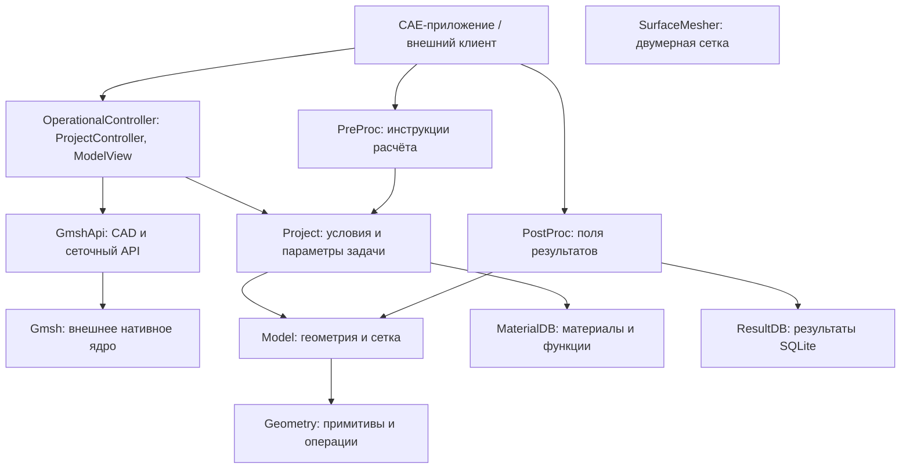

# BazisCORE

## Назначение и возможности

BazisCORE - набор библиотек на C# для разработчиков CAE-приложений и специализированных инженерных инструментов. Решение предоставляет общую основу для подготовки расчётных моделей, управления физическими данными и обработки результатов численного моделирования. Ядро не зависит от конкретного графического клиента: приложения используют его данные, операции и уведомления об изменениях.

Основные задачи и функции:

- **Подготовка модели:** геометрические примитивы и системы координат, импорт CAD через Gmsh, построение и редактирование сетки, создание групп узлов и элементов, поиск границ и построение сечений.
- **Описание физической задачи:** назначение материалов, свойств сред, нагрузок, закреплений и тепловых условий, работа с источниками тепла и подвижными системами координат.
- **Подготовка расчёта:** формирование TSF-инструкций по временным этапам для тепловых, механических и связанных термомеханических задач, передача теплового поля в механический этап. Численный расчёт выполняет внешний решатель.
- **Обработка результатов:** чтение и сохранение результатов в SQLite, работа с временными срезами, построение полей и цветовых шкал для визуализации.
- **Хранение и интеграция:** чтение и сохранение проектов и моделей, повторное использование баз материалов и функций, подготовка данных представления через `ModelView` и уведомление клиента через `ProjectController`.

Полная поддержка химических и гидродинамических расчётов пока не реализована: наличие контрактов физических полей не означает готовность соответствующего расчётного пути. Подробнее: [задачи решения](Documents/BusinessTasks.md), [каталог функций и ограничений](Documents/Features.md), [реализация](Documents/Implementation.md).

## Компоненты решения

На схеме стрелка означает использование компонента. Клиент и численный решатель находятся за пределами решения; подготовленные `PreProc` инструкции передаются решателю клиентским приложением.



`SurfaceMesher` входит в решение как отдельная библиотека; прямых ссылок на него из показанных компонентов нет. Состав и зависимости определены в [BazisCore.sln](BazisCore.sln) и файлах проектов. Подробности: [архитектура](Documents/Architecture.md), [контракт физических полей](Documents/PhysicalFields.md).

## Поддерживаемые ОС

| ОС | Поддержка и необходимые ресурсы |
| --- | --- |
| Windows | Предусмотрена загрузка нативной библиотеки `gmsh.dll`. Для скачивания внешних ресурсов нужен Git Bash. |
| Linux | Предусмотрена загрузка `libgmsh.so` через `libdl.so.2`. В настройках тестового окружения указан WSL с Ubuntu 24.04. |
| macOS | Поддержка нативного Gmsh в текущем загрузчике не реализована. |

Основные библиотеки ориентированы на .NET 8; `GmshApi` и `ResultDB` - на .NET Standard 2.0. Для сборки решения требуется .NET SDK 8. Работоспособность операций CAD, сеточного генератора и SQLite зависит также от доступности совместимых нативных библиотек и их зависимостей для выбранной ОС и архитектуры. Таблица описывает предусмотренные платформы, а не результаты полной проверки всех функций на каждой ОС.

Основание: [загрузчик Gmsh](GmshApi/GmshKernel.cs), [проект контроллера](OperationalController/OperationalController.csproj), [проект ResultDB](ResultDataBase/ResultDB.csproj), [тестовое окружение](testEnvironments.json).

## Внешние ресурсы

Крупные бинарные файлы и часть тестовых данных хранятся в **Yandex Object Storage** и загружаются по запросу. В Git хранятся соседние файлы `.manifest` с SHA-256 и ETag.

| Ресурсы | Бакет | Локальное размещение |
| --- | --- | --- |
| Нативные библиотеки Gmsh для Windows и Linux | `outlibs` | `GmshApi/gmsh.dll`, `GmshApi/libgmsh.so` |
| Примеры STL-моделей | `outcommon` | `TestModelCore/Examples/STL/` |
| Базы материалов и функций для тестов | `outcommon` | `TestProject/MaterialDB/Data/` |

Для получения ресурсов установите AWS CLI и настройте профиль `yandex` с доступом к указанным бакетам. Другой профиль можно выбрать через `AWS_PROFILE`. Запустите из корня репозитория в Bash (на Windows - Git Bash):

```bash
bash .githooks/pull_large_files.sh
```

Скрипт обращается к облаку через AWS CLI, проверяет ETag и контрольные суммы и при необходимости скачивает файлы. Загрузка проходит через временный файл с проверками перед заменой локальной копии. Для Gmsh облачная версия является актуальной; её обновление может изменить отслеживаемый `.manifest`. Остальные ресурсы должны соответствовать SHA-256, указанному в манифесте.

Проверку ресурсов после слияния, перебазирования или переключения ветки можно включить отдельно:

```bash
git config --local core.hooksPath .githooks
```

В новом клоне эти хуки автоматически не включаются. Подробные пути объектов, требования и порядок проверки описаны в [LARGE_FILES.md](LARGE_FILES.md); фактическое поведение задаёт [скрипт загрузки](.githooks/pull_large_files.sh). Интернет и доступ к хранилищу нужны при запуске этого скрипта.

## Лицензирование

Текст условий использования, воспроизведения и распространения размещён в [LICENSE.txt](LICENSE.txt). Он предусматривает использование, копирование, изменение и распространение при соблюдении перечисленных условий: передаче копии лицензии, обозначении изменённых файлов, сохранении применимых уведомлений и включении `Notice`, если такой файл входит в распространяемое произведение. ПО предоставляется «КАК ЕСТЬ», без гарантий; права на товарные знаки отдельно не предоставляются.

**В репозитории есть расхождение:** в метаданных ряда NuGet-проектов указано `PackageLicenseExpression=MIT`, но содержимое `LICENSE.txt` не является текстом MIT. Например, это видно в [Model.csproj](Model/Model.csproj) и [Project.csproj](Project/Project.csproj). Условия исходников и метаданные пакетов требуют согласования правообладателем; этот README не устраняет расхождение и не назначает новую лицензию.

Внешние библиотеки и ресурсы, включая Gmsh и SQLite, имеют собственные лицензионные условия, которые следует учитывать при их использовании и распространении вместе с приложением.

## Подробные спецификации

Классы и интерфейсы нетестовых проектов раскрыты в нумерованных `.mdpuml`, перечисленных в [архитектурной документации](Documents/Architecture.md). Там же описана целевая архитектура уведомлений, сосредоточенная в `ProjectController`, и незавершённая миграция событий нижних библиотек.

Ниже сохранены прежние описания и иллюстрации. Они служат справочными материалами и не являются рендером обновлённых контрактов.

**принятые обозначения:**  
(->) наследование от класса<br/>

В состав входят следующие библиотеки:
- Project (ProjectData: библиотека, хранящая и управляющая граничными условиями,сеточными и геометрическими сущностями. Осуществляет функции CRUD над перечисленными объектами)
  + TaskData
    > Functions
      <details>
      - SphereFunction -> Arc<br/>
      - CillindricalFunction -> Lazer<br/>
      - CillindricalFunction -> FSWPin<br/>
      - CillindricalFunction -> FSWShoulder<br/>
      </details>
    > PhysicalData (абстрактный класс для хранения физических данных об условиях задачи)<br/>
    > PhysicalData -> HeatData<br/>
    > PhysicalData -> LoadData<br/>
    > PhysicalData -> MatData<br/>
    > PhysicalData -> MediaData<br/>
    > PhysicalData -> ClampData<br/>
  + ModelData
    > ObjectData<br/>
    > GroupData
- Geometry (геометрические примитивые: **точка**, **линия**, **плоскость**,**система координат** и методы работы с ними. Также векторные операции)
- GmshApi (интерфейс с добавленными функциями к GMSH сеточному генератору. Спецификация ниже)
- Model (библиотека, хранящая сеточные и геометрические сущности: узел сетки или геометрии, элементы, поверхности и т.д. Осуществляет функции CRUD над перечисленными объектами)
  + ModelData
    > ObjectData (класс для хранения коллекций ObjectsCollection)
      - ObjectsCollection (класс для хранения наборов ObjectsSet)
        + ObjectsSet (класс для хранения геометрических **GeometryObjects** и сеточных **MeshObjects** сущностей ModelObject)
          <details>
          > ModelObject -> beam<br/>
          > ModelObject -> Node<br/>
          > ModelObject -> Hexa<br/>
          > ModelObject -> Penta<br/>
          > ModelObject -> Tetra<br/>
          > ModelObject -> Tetra_c<br/>
          > ModelObject -> Triangle<br/>
          > ModelObject -> Triangle_c<br/>
          > ModelObject -> Quad<br/>
          > ModelObject -> Curve<br/>
          > ModelObject -> GeometryPoint<br/>
          > ModelObject -> SurfaceFigure<br/>
          > ModelObject -> VolumeFigure<br/>
          </details>
    > GroupData (класс для хранения ссылок на геометрические и сеточные сущности ModelObject)
- OperationalController (`ProjectController` координирует проект, геометрию, сетку и уведомления; службы выполняют агрегатные функции:
  + Построение сечения внутри элементов сетки
  + Поиск контуров сетки
  + Поиск открытых поверхностей
  + Поиск свободных узлов (не зависящих от сетки)
  + Поиск связанных узлов (узел - набор связанных узлов через ребра элементов)
  + Продвинутый выбор
  + Генерация массивов данных для вывода на экран, используя спецификацию OpenGL
  + Генерация 2d элементов на открытых поверхностях 3d
  + Генерация 1d элементов на открытых границах 2d
- PostProc (генерация поля результатов на открытых поверхностях элементов, участвующих в расчетах)
- PreProc (автоматизированое создание инструкций согласно типу и виду задачи, а также набору граничных условий)
  
**MeshObjects** (набор классов реализующих конкретные сеточные сущности: Node,Hexa,Penta и т.д.)

**GeometryObjects** (набор классов реализующих конкретные геометрические сущности: GeometryPoint, Curve и т.д.)

# Приложения
**Спецификация Model**
<details>
<br/>
<br/>
<br/>

</details>
__________

**Спецификация GmshApi**
 <details>

</details>
__________

**Схемы интегрирования конечных элементов для решения задач для всех типов элементов 2D и 3D (Проект Model)**

Естественные функции формы и их производные для различных элементов:
**Beam (одномерный элемент)<br/>**

Функции формы и их производные:<br/>
N_i=(1/2)*(1-ξ)<br/>
N_j=(1/2)*(1+ξ)<br/>
(dN_i)/dξ=-1/2<br/>
(dN_j)/dξ=1/2<br/>


**Пентаэдр (Пента)**


Xi, Xj, …Xn - функции формы для пенты (Ni,Nj,…Nn – другое обозначение тех же самых функций форм):


Производные функции форм:
<details>
(dN_i)/dξ=-(1-ζ)/2<br/>
(dN_j)/dξ=(1-ζ)/2<br/>
(dN_k)/dξ=0<br/>
(dN_l)/dξ=-(1+ζ)/2<br/>
(dN_m)/dξ=(1+ζ)/2<br/>
(dN_n)/dξ=0<br/>
<br/>
(dN_i)/dη=-(1-ζ)/2<br/>
(dN_j)/dη=0<br/>
(dN_k)/dη=(1-ζ)/2<br/>
(dN_l)/dη=-(1+ζ)/2<br/>
(dN_m)/dη=0<br/>
(dN_n)/dη=(1+ζ)/2<br/>
<br/>
(dN_i)/dζ=-(1-ξ-η)/2<br/>
(dN_j)/dζ=-ξ/2<br/>
(dN_k)/dζ=-η/2<br/>
(dN_l)/dζ=(1-ξ-η)/2<br/>
(dN_m)/dζ=ξ/2<br/>
(dN_n)/dζ=η/2<br/>
</details>

**Гексаэдр (Гекса)**

  Линейные функции формы для восьмиузлового гексаэдра описываются полиномами первой степени и обеспечивают непрерывность решения на границах элементов.
Изопараметрическая формулировка позволяет использовать те же функции для описания геометрии элемента и для аппроксимации искомых функций.
Естественные координаты (ξ, η, ζ) варьируются в пределах от -1 до 1, что упрощает запись функций формы.


Для восьмиузлового гексаэдра функции формы имеют вид:

$N_i(ξ,η,ζ) = \frac{1}{8}(1+ξ_iξ)(1+η_iη)(1+ζ_iζ)$, 

где i = 1...8 - номер узла, а ξ_i, η_i, ζ_i - координаты соответствующего узла в естественных координатах. Подробнее ниже:
<details>
N_1=1/8*(1-ξ)(1-η)(1-ζ)<br/>
N_2=1/8*(1+ξ)(1-η)(1-ζ)<br/>
N_3=1/8*(1+ξ)(1+η)(1-ζ)<br/>
N_4=1/8*(1-ξ)(1+η)(1-ζ)<br/>
N_5=1/8*(1-ξ)(1-η)(1+ζ)<br/>
N_6=1/8*(1+ξ)(1-η)(1+ζ)<br/>
N_7=1/8*(1+ξ)(1+η)(1+ζ)<br/>
N_8=1/8*(1-ξ)(1+η)(1+ζ)<br/>
</details>

Производные функций форм выглядят следующим образом:
<details>
(∂N_1)/∂ξ=-1/8*(1-η)(1-ζ)<br/>
(∂N_2)/∂ξ=1/8*(1-η)(1-ζ)<br/>
(∂N_3)/∂ξ=1/8*(1+η)(1-ζ)<br/>
(∂N_4)/∂ξ=-1/8*(1+η)(1-ζ)<br/>
(∂N_5)/∂ξ=-1/8*(1-η)(1+ζ)<br/>
(∂N_6)/∂ξ=1/8*(1-η)(1+ζ)<br/>
(∂N_7)/∂ξ=1/8*(1+η)(1+ζ)<br/>
(∂N_8)/∂ξ=-1/8*(1+η)(1+ζ)<br/>
<br/>
(∂N_1)/∂η=-1/8*(1-ξ)(1-ζ)<br/>
(∂N_2)/∂η=-1/8*(1+ξ)(1-ζ)<br/>
(∂N_3)/∂η=1/8*(1+ξ)(1-ζ)<br/>
(∂N_4)/∂η=1/8*(1-ξ)(1-ζ)<br/>
∂N/∂η=-1/8*(1-ξ)(1+ζ)<br/>
(∂N_6)/∂η=-1/8*(1+ξ)(1+ζ)<br/>
(∂N_7)/∂η=1/8*(1+ξ)(1+ζ)<br/>
(∂N_8)/∂η=1/8*(1-ξ)(1+ζ)<br/>
<br/>
(∂N_1)/∂ζ=-1/8*(1-ξ)(1-η)<br/>
(∂N_2)/∂ζ=-1/8*(1+ξ)(1-η)<br/>
(∂N_3)/∂ζ=-1/8*(1+ξ)(1+η)<br/>
(∂N_4)/∂ζ=-1/8*(1-ξ)(1+η)<br/>
(∂N_5)/∂ζ=1/8*(1-ξ)(1-η)<br/>
(∂N_6)/∂ζ=1/8*(1+ξ)(1-η)<br/>
(∂N_7)/∂ζ=1/8*(1+ξ)(1+η)<br/>
(∂N_8)/∂ζ=1/8*(1-ξ)(1+η)<br/>
</details>


**Двойной эллипсоид**


