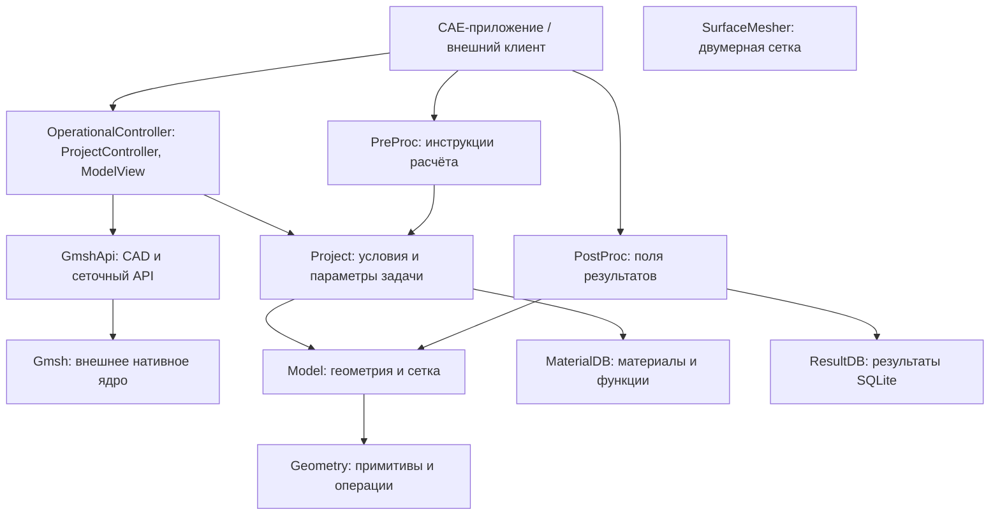

# BazisCORE

## Назначение и возможности

BazisCORE - набор библиотек на C# для разработчиков CAE-приложений и специализированных инженерных инструментов. Решение предоставляет общую основу для подготовки расчётных моделей, управления физическими данными и обработки результатов численного моделирования. Ядро не зависит от конкретного графического клиента: приложения используют его данные, операции и уведомления об изменениях.

Основные задачи и функции:

- **Подготовка модели:** геометрические примитивы и системы координат, импорт CAD через Gmsh, построение и редактирование сетки, создание групп узлов и элементов, поиск границ и построение сечений.
- **Описание физической задачи:** назначение материалов, свойств сред, нагрузок, закреплений и тепловых условий, работа с источниками тепла и подвижными системами координат.
- **Подготовка расчёта:** формирование TSF-инструкций по временным этапам для тепловых, механических и связанных термомеханических задач, передача теплового поля в механический этап. Численный расчёт выполняет внешний решатель.
- **Обработка результатов:** чтение и сохранение результатов в SQLite, работа с временными срезами, построение полей и цветовых шкал для визуализации.
- **Хранение и интеграция:** чтение и сохранение проектов и моделей, повторное использование баз материалов и функций, подготовка данных представления через `ModelView` и уведомление клиента через `ProjectController`.

Полная поддержка химических и гидродинамических расчётов пока не реализована: наличие контрактов физических полей не означает готовность соответствующего расчётного пути. Подробнее: [задачи решения](Documents/BusinessTasks.md), [каталог функций и ограничений](Documents/Features.md), [реализация](Documents/Implementation.md).

## Компоненты решения

На схеме стрелка означает использование компонента. Клиент и численный решатель находятся за пределами решения; подготовленные `PreProc` инструкции передаются решателю клиентским приложением.



`SurfaceMesher` входит в решение как отдельная библиотека; прямых ссылок на него из показанных компонентов нет. Состав и зависимости определены в [BazisCore.sln](BazisCore.sln) и файлах проектов. Подробности: [архитектура](Documents/Architecture.md), [контракт физических полей](Documents/PhysicalFields.md).

## Поддерживаемые ОС

| ОС | Поддержка и необходимые ресурсы |
| --- | --- |
| Windows | Предусмотрена загрузка нативной библиотеки `gmsh.dll`. Для скачивания внешних ресурсов нужен Git Bash. |
| Linux | Предусмотрена загрузка `libgmsh.so` через `libdl.so.2`. В настройках тестового окружения указан WSL с Ubuntu 24.04. |
| macOS | Поддержка нативного Gmsh в текущем загрузчике не реализована. |

Основные библиотеки ориентированы на .NET 8; `GmshApi` и `ResultDB` - на .NET Standard 2.0. Для сборки решения требуется .NET SDK 8. Работоспособность операций CAD, сеточного генератора и SQLite зависит также от доступности совместимых нативных библиотек и их зависимостей для выбранной ОС и архитектуры. Таблица описывает предусмотренные платформы, а не результаты полной проверки всех функций на каждой ОС.

Основание: [загрузчик Gmsh](GmshApi/GmshKernel.cs), [проект контроллера](OperationalController/OperationalController.csproj), [проект ResultDB](ResultDataBase/ResultDB.csproj), [тестовое окружение](testEnvironments.json).

## Внешние ресурсы

Крупные бинарные файлы и часть тестовых данных хранятся в **Yandex Object Storage** и загружаются по запросу. В Git хранятся соседние файлы `.manifest` с SHA-256 и ETag.

| Ресурсы | Бакет | Локальное размещение |
| --- | --- | --- |
| Нативные библиотеки Gmsh для Windows и Linux | `outlibs` | `GmshApi/gmsh.dll`, `GmshApi/libgmsh.so` |
| Примеры STL-моделей | `outcommon` | `TestModelCore/Examples/STL/` |
| Базы материалов и функций для тестов | `outcommon` | `TestProject/MaterialDB/Data/` |

Для получения ресурсов установите AWS CLI и настройте профиль `yandex` с доступом к указанным бакетам. Другой профиль можно выбрать через `AWS_PROFILE`. Запустите из корня репозитория в Bash (на Windows - Git Bash):

```bash
bash .githooks/pull_large_files.sh
```

Скрипт обращается к облаку через AWS CLI, проверяет ETag и контрольные суммы и при необходимости скачивает файлы. Загрузка проходит через временный файл с проверками перед заменой локальной копии. Для Gmsh облачная версия является актуальной; её обновление может изменить отслеживаемый `.manifest`. Остальные ресурсы должны соответствовать SHA-256, указанному в манифесте.

Проверку ресурсов после слияния, перебазирования или переключения ветки можно включить отдельно:

```bash
git config --local core.hooksPath .githooks
```

В новом клоне эти хуки автоматически не включаются. Подробные пути объектов, требования и порядок проверки описаны в [LARGE_FILES.md](LARGE_FILES.md); фактическое поведение задаёт [скрипт загрузки](.githooks/pull_large_files.sh). Интернет и доступ к хранилищу нужны при запуске этого скрипта.

## Лицензирование

Всё решение BazisCORE распространяется по лицензии **GNU General Public License version 3 (GPLv3)**.

Полный текст условий: [GNU GPLv3](https://www.gnu.org/licenses/gpl-3.0.html).
